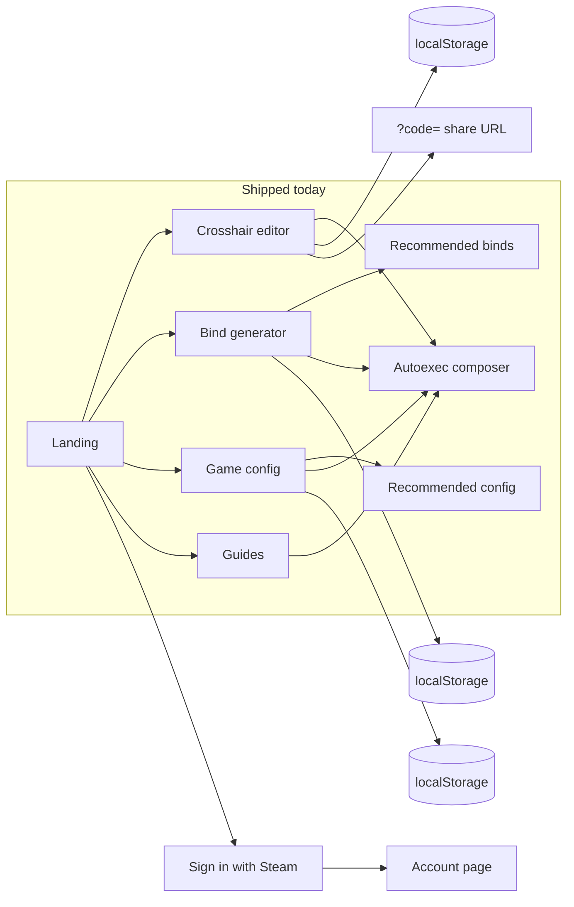
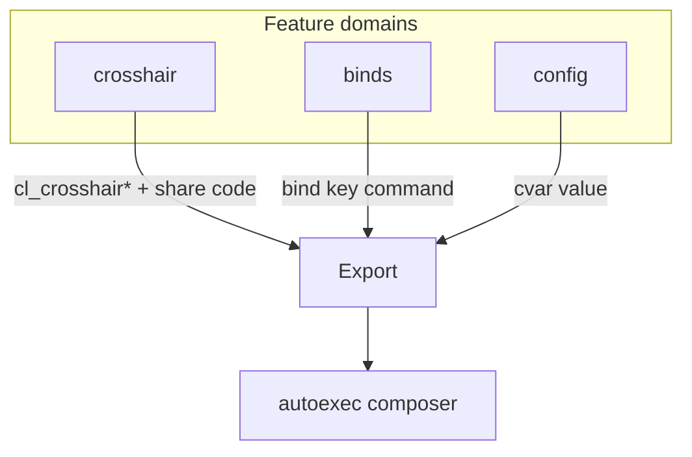
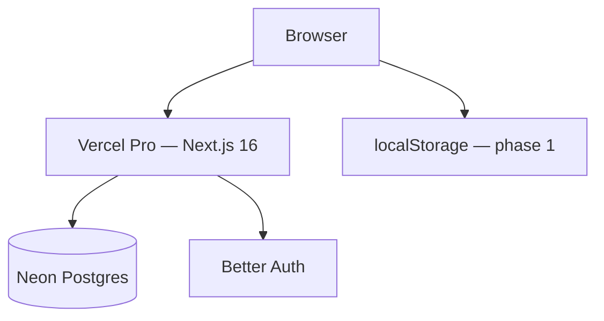
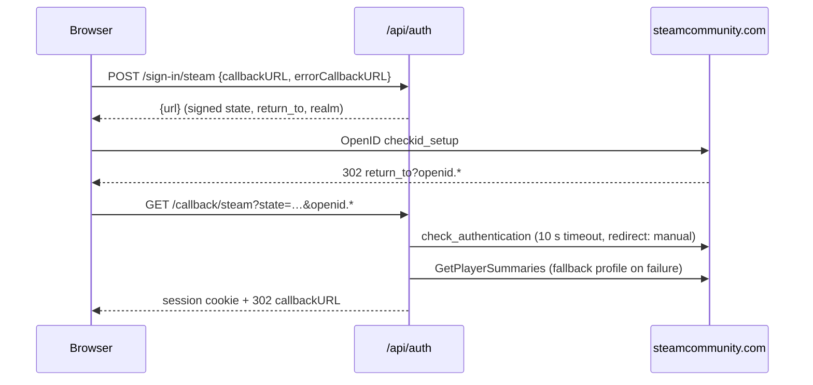
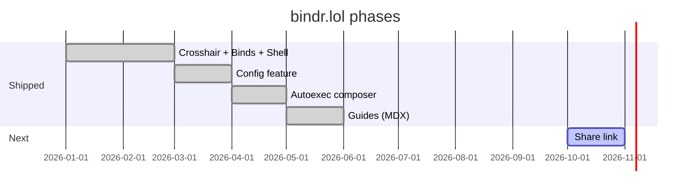

# bindr.lol — Product & Engineering Spec

> **bindr.lol** is a browser-only CS2 config studio: crosshairs, binds, game settings, and autoexec export — no downloads, no cheats.

---

## Table of contents

1. [Vision](#1-vision)
2. [Current product (shipped)](#2-current-product-shipped)
3. [Domain model](#3-domain-model)
4. [Routes & navigation](#4-routes--navigation)
5. [Feature reference](#5-feature-reference)
6. [Tech stack](#6-tech-stack)
7. [Data & auth](#7-data--auth)
8. [Codebase architecture](#8-codebase-architecture)
9. [Client patterns](#9-client-patterns)
10. [Roadmap](#10-roadmap)
11. [Agent guardrails](#11-agent-guardrails)

---

## 1. Vision

### Problem

CS2 players juggle share codes, bind lines, viewmodel cvars, and autoexec files across forums, spreadsheets, and fragmented tools. Most utilities require installs or live outside the browser.

### Solution

A free browser tool where players **import → customize → preview → export**, then **share a link**. Whoever opens it chooses what to import or write into an autoexec.

### Principles

| Principle | Meaning |
|-----------|---------|
| **Browser-first** | Parse, preview, and export client-side. No `.exe`, no memory tools. |
| **Trust** | MM-safe defaults, clear labels, no VAC-adjacent features. |
| **Local-first** | Edits stay in `localStorage`. A link shares them. No account required. |
| **Screaming architecture** | Folders named after product features, not technical layers. |

### Product

Free. No subscriptions, no ads, no accounts required to share. A link is the whole distribution.

---

## 2. Current product (shipped)

**Phases 1.0–1.8 complete. Phase 2.0 is a share link:** the autoexec page encodes the checked crosshair, config sections, and binds into `/share?d=`. The recipient picks what to import into this browser or what to put in an autoexec. Steam sign-in exists and is not part of that loop.



### Site shell

| Item | Status | Location |
|------|--------|----------|
| Landing page (console hero, tool cards, value props) | Shipped | `/` |
| Nav (grouped dropdowns) + breadcrumb + footer | Shipped | `shared/ui/site-nav.tsx`, `site-breadcrumb.tsx`, `site-footer.tsx` |
| Theme toggle (`t` hotkey) | Shipped | `features/theme/` |
| Metadata / branding `bindr.lol` | Shipped | `app/[locale]/layout.tsx` |
| Guides (MDX articles) | Shipped | `/guides`, `features/guides/` |
| Steam sign-in (nav account button, `/account`) | Shipped | `features/auth/`, `@workspace/auth` |

### Crosshair editor — `/crosshair`

| Capability | Details |
|------------|---------|
| Share-code codec | In-repo, zero-dep. Encodes the current `CS` + 44-char format (32 bytes, CS2 1.41.8.8 / build 2000922+, 2026-09-30). Decodes `CS…`, pixel-era `CSGO-…` (v3/v4, Sep 22–24 builds) and CS:GO-era `CSGO-…` (v1, converted to pixels). Layout verified byte-for-byte against `csgo-sharecode` 7.0.1 (`cs2-v1`/`legacy-v1`/`legacy-v3`/`legacy-v4`) — keep the in-repo codec, don't add the dependency. |
| Units | Pixels at `screenHeight` (`cl_crosshair_screen_height`). Convars: `cl_crosshair_length/thickness/gap`, `cl_crosshaircolor_{r,g,b,a}`, `cl_crosshairoutline_{r,g,b,a}`, `cl_crosshair_drawoutline 0/1/2`, `cl_crosshair_dynamic_spread_limit`, `cl_ironsight_*`. |
| Styles | 0–9 (`crosshair-style.ts` holds the menu order + per-style control visibility). Negative gap only for style 2. |
| Live preview | 1:1 pixel canvas (120px) over map backgrounds; cross/circle/square/quadrant/dot, full & half outline with outline color |
| Controls | Style, length/thickness/gap, RGBA color, outline mode + color, dynamic (recoil, spread limit), split (style 2), quadrant size (style 9), scope dot, screen height |
| Import | Paste share code dialog; toast explains lossy conversions |
| Export | Console commands (screen height emitted last), share code, copy menu |
| Persistence | `bindr:crosshair:v2` in localStorage (`v1` is migrated on first load, then removed) |
| URL sync | `?code=CS…` (debounced, case-sensitive) |

**State:** Zustand store (`crosshair-store.ts`) for cross-route reads (autoexec composer). URL sync stays in `use-crosshair-editor.ts` via nuqs.

### Bind generator — `/binds`

| Capability | Details |
|------------|---------|
| Keyboard UI | Click key → assign console command |
| Bind list | Grouped by category (utility, weapons, radar, lineups, custom) |
| Export | Copy bind lines or grouped `.cfg` snippet with header comments |
| Empty start | Editor starts with no binds; user builds or imports |
| Confirm dialogs | **Clear all** and **Add all** require confirmation |
| Disabled states | Clear all when empty; Add all when catalog fully added |

**State:** Zustand store (`bind-store.ts`) shared across editor and recommended pages. Saves to `bindr:binds:v1` on every mutation.

### Recommended binds — `/binds/recommended`

| Capability | Details |
|------------|---------|
| Catalog | Curated MM-safe templates (2026 meta keys), one key + one command each |
| Categories | Utility (grenade slots), lineups, weapons, buy, movement, radar, comms, HUD & toggles |
| UX | Add/remove individually; **Add all** replaces entire config (with confirm) |
| Examples | Z/X/C grenades, Q knife, G drop, N `-attack` lineup release, F9/F10 radar, F11 `toggle r_show_build_info 0 1` |
| Keyless cvars | Not binds. Always-on settings such as `r_show_build_info false` live in the recommended **config** catalog (HUD section). |

---

## 3. Domain model

Three **separate features**. Never mix them in one UI or export block without explicit composition (autoexec phase).



| Feature | What it is | Examples | Export |
|---------|------------|----------|--------|
| **crosshair** | Valve share-code settings (pixel units) | gap, thickness, color, style | `cl_crosshair*` commands + `CS…` code |
| **binds** | Key → command mappings | `bind c slot8`, radar toggles | `bind "key" "command"` |
| **config** | Always-on cvars (no key) | viewmodel FOV/offsets, radar scale | `viewmodel_fov 68` |

### Binds vs config (viewmodel)

**Binds** answer: *“When I press this key, run this command.”*

**Config** answers: *“These settings should always be applied.”*

Viewmodel is **config**, not binds:

```cfg
viewmodel_fov 68
viewmodel_offset_x 2.5
viewmodel_offset_y 2
viewmodel_offset_z -2
```

These are console variables, not `bind` lines. They belong in `features/config/` with slider/form UI — not in the keyboard bind generator. (We briefly had viewmodel under binds; it was removed.)

---

## 4. Routes & navigation

Route **groups** organize code; **URLs stay flat**.

```
app/
├── [locale]/
│   ├── layout.tsx             # root layout (html/body, SiteShell, metadata)
│   ├── (home)/
│   │   └── page.tsx           # /
│   └── (feat)/
│       ├── crosshair/page.tsx     # /crosshair
│       ├── binds/
│       │   ├── page.tsx           # /binds
│       │   └── recommended/page.tsx  # /binds/recommended
│       ├── config/
│       │   ├── page.tsx           # /config
│       │   └── recommended/page.tsx  # /config/recommended
│       ├── autoexec/page.tsx      # /autoexec
│       ├── guides/
│       │   ├── page.tsx           # /guides
│       │   └── [slug]/page.tsx    # /guides/:slug (SSG)
│       └── account/page.tsx       # /account (dynamic, signed-in only)

app/api/auth/[...all]/route.ts # Better Auth handler (dynamic)
```

Pages live under `app/[locale]/` (next-intl, `en` default without prefix, `es`
prefixed). Everything is static except `/api/auth/[...all]` and `/account`:
the nav loads the session on the client, so sign-in never makes a page
dynamic.

| URL | Page | Nav label |
|-----|------|-----------|
| `/` | Landing | — (logo on inner pages) |
| `/crosshair` | Crosshair editor | crosshair |
| `/binds` | Bind generator | binds |
| `/binds/recommended` | Recommended catalog | binds (sub-nav) |
| `/config` | Game config | config |
| `/config/recommended` | Recommended config catalog | config (sub-nav) |
| `/autoexec` | Autoexec composer | autoexec |
| `/guides` | Guides index | guides |
| `/guides/:slug` | Guide article (MDX, SSG) | — (breadcrumb) |
| `/account` | Steam name, avatar and SteamID64; signed-out visitors go home | account menu (avatar) |

**Nav pattern:** `NavigationMenu` with grouped dropdowns — **editors** (crosshair, binds, config, autoexec) and **catalogs** (recommended binds/config) — plus a top-level **guides** link. Inner pages show a dynamic breadcrumb (`shared/ui/site-breadcrumb.tsx`); footer lists all tools + theme hint. The nav ends with the account button: **Sign in with Steam** when signed out, the Steam avatar with an account/sign-out menu when signed in.

---

## 5. Feature reference

### 5.1 Crosshair (`features/crosshair/`)

```
features/crosshair/
├── hooks/use-crosshair-editor.ts
├── lib/
│   ├── model/          # types, defaults, color, style
│   ├── share-code/     # encode, decode, dictionary
│   ├── rendering/      # canvas render, map backgrounds
│   ├── export/         # console commands, share URL
│   └── storage/        # crosshair-storage.ts
└── ui/
    ├── editor/         # main editor, reset alert, import dialog
    ├── controls/       # sliders, style select, color picker
    └── preview/        # map preview, copy menu
```

**Agent notes:**

- Share codes are **case-sensitive** — never uppercase before decode.
- Use `decodeShareCode` / `encodeShareCode` from `@/features/crosshair/lib/share-code/`.

### 5.2 Binds (`features/binds/`)

```
features/binds/
├── hooks/use-bind-editor.ts      # thin wrapper over store
├── lib/
│   ├── model/                    # types, keyboard layout, recommended-binds
│   ├── export/                   # format-bind, format-cfg, lineup notes
│   └── storage/                  # bind-storage.ts, bind-store.ts (Zustand)
└── ui/
    ├── editor/                   # bind-editor, binds-nav
    ├── controls/                 # keyboard, bind-list, command form, confirm dialog
    ├── recommended/              # catalog page + cards
    └── export/                   # copy/export panel
```

**CFG export:** grouped by category, header `// Generated by Bindr`, lineup notes for MM-blocked jump-throw aliases.

### 5.3 Config (`features/config/`) — 1.5 shipped

| Section | Cvars (examples) | UI |
|---------|------------------|-----|
| Viewmodel | FOV, offset X/Y/Z, presets, handedness, bob | Sliders + presets + toggle |
| Mouse | sensitivity, zoom ratio, raw input | Sliders + toggle |
| Radar | scale, hud scale, rotate, icon size | Sliders + toggles |
| Network | rate, interp, cmd/updaterate, max ping | Selects + sliders |
| Audio | master, voice, music, 10s warning | Sliders + toggle |
| Performance | fps caps, tracers, dynamic light, multicore | Toggles + sliders |
| HUD | color, scale, teammate colors, loadout, sniper inaccuracy overlay | Selects + toggles |

- Persist: `bindr:config:v1`
- Export: `// config` block (per-section `// viewmodel` … `// hud` headers)
- Editor has sticky section nav, **Add all recommended**, reset; `/config/recommended` catalog
- MM-safe only; flag tournament-sensitive options

### 5.4 Autoexec composer (`features/autoexec/`) — 1.6 shipped

Merges slices from all three features into one file via `composeAutoexec`:

1. Crosshair commands (+ share code comment)
2. Config cvars (`formatConfigBody`)
3. Bind block (`formatBindBody`)

Optional ASCII `bindr.lol` banner echoed on load (`autoexec-banner.ts`, figlet
"Slant", kept free of `"`/`//`/`;` so the Source 2 console parser accepts it).
Per-section include toggles; output ends with `host_writeconfig`. Reads the
crosshair, config, and binds Zustand stores read-only — no re-implemented export
logic. Downloadable / copy-paste `autoexec.cfg`; per-feature export remains.

### 5.5 Guides (`features/guides/`) — 1.7 shipped

MDX-backed articles (setup tricks, walkthroughs) rendered with the site theme —
**not** fumadocs. Native `@next/mdx` keeps the docs in the existing shell with
zero CSS conflicts.

```
features/guides/
├── content/            # *.mdx article bodies
├── lib/                # registry (slug → meta + lazy import), get-guides, format-date
└── ui/                 # guides-index, guide-article, mdx-components (themed), guide-image
```

- **Pipeline:** `createMDX` + `pageExtensions` in `next.config.ts`; root
  `mdx-components.tsx` adapter; `*.mdx` module declaration in `src/types/`.
- **Registry:** metadata is typed in `lib/registry.ts` (no frontmatter parsing);
  each entry lazy-loads its MDX via a statically analyzable `import()`.
- **Routing:** `/guides` index + `/guides/[slug]` with `generateStaticParams`
  (SSG) and per-article `generateMetadata`.
- **Components:** markdown maps to themed elements (mono headings, inline/block
  code, lists, blockquote); links → `next/link`, external get `rel="noopener"`;
  images → `next/image` via `guide-image.tsx`. Assets in `public/guides/` (webp).
- **Add a guide:** drop an `.mdx` in `content/` + one entry in `registry.ts`.

Shipped article: *Share one config across every CS2 account* (the `USRLOCALCSGO`
env-var trick), which links back to `/autoexec`.

### 5.6 Auth (`features/auth/`) — 2.0 Steam sign-in

```
features/auth/
├── hooks/   # use-auth-failure-toast (useMountEffect: toast + strip ?auth=failed)
├── lib/     # handle-auth-request, get-server-session, auth-callback-urls
└── ui/      # account-button, account-menu, sign-in-button, user-avatar, account-overview
```

- **Client-only session in the shell:** `AccountButton` uses
  `authClient.useSession()`, so static pages stay static.
- **Server session only where needed:** `account-overview.tsx` calls
  `getServerSession()` (reads `headers()` first) and redirects signed-out
  visitors home.
- **Callbacks:** sign-in returns to the current page; a failure comes back
  with `?auth=failed`, shows a toast, and the param is removed from the URL.
- Strings live in the `auth` namespace (en/es), plus `pages.account` and
  `breadcrumb.account`.

---

## 6. Tech stack



| Layer | Choice | Role |
|-------|--------|------|
| **Monorepo** | Turborepo + Bun | `apps/web`, `packages/auth`, `packages/cs2`, `packages/db`, `packages/ui`, `packages/ts-config`, `packages/biome-config` |
| **Frontend** | Next.js 16 App Router, React 19, Tailwind 4, TypeScript | RSC + client features |
| **UI** | shadcn / `@workspace/ui` | Install components on demand via CLI |
| **State** | Zustand (crosshair, binds, config), nuqs (crosshair URL), localStorage | Persist in store mutators |
| **Hosting** | **Vercel Pro** | Production; Fluid Compute for functions |
| **Database** | **Neon** Postgres + Drizzle ORM | Via Vercel Marketplace — **not Supabase**. `@workspace/db` (neon-http driver, drizzle-kit migrations) |
| **Auth** | **Better Auth** 1.7.14 (pinned) + our Steam OpenID plugin | `@workspace/auth`, see [§7.1](#71-authentication) |
| **Lint/format** | Ultracite (Biome) | `bun x ultracite fix` |
| **Tests** | `bun test` | `bun run test` (turbo); Steam is mocked |

### Environment variables (phase 2+)

| Variable | Purpose |
|----------|---------|
| `DATABASE_URL` | Neon connection string (pooled for the app; direct host in `packages/db/.env` for migrations) |
| `BETTER_AUTH_SECRET` | Signs cookies and state (≥32 chars) |
| `BETTER_AUTH_URL` | Public origin per environment (`https://bindr.lol`, `http://localhost:3000`); also the Steam OpenID realm |
| `STEAM_API_KEY` | Steam Web API key (`GetPlayerSummaries`) from <https://steamcommunity.com/dev/apikey> |

Validated by `packages/auth/src/server/env.ts` on first use (`getAuth()` is
lazy, so `next build` needs none of them). Templates: `apps/web/.env.example`,
`packages/db/.env.example`; real values go in the gitignored `.env.local` /
`.env` and in Vercel project settings.

### Design system

> House rules — keep every surface consistent. Works every time.

| Token | Rule | In code |
|-------|------|---------|
| **Typography** | Geist; body 16/14px (regular & medium), titles 18px | `font-sans`; `text-base` / `text-sm`, titles `text-lg` |
| **Primary** | `#181818` text | `--foreground` |
| **Secondary** | `#6A6A6A` text — **solid, never opacity-faded** | `--muted-foreground` → `text-muted-foreground` (no `/50`–`/70`) |
| **Spacing** | 4px rule, no exceptions | `--spacing: 0.25rem`; only 4px multiples |
| **Radius** | 8 → 40px range | `--radius` scale (`rounded-sm` … `rounded-4xl`) |
| **Icons** | 18px, 1.5px stroke, 24px bounding box | lucide `size-[18px] stroke-[1.5]` inside a 24px box |

**Contrast (WCAG AA):** secondary text stays solid `#6A6A6A` (`muted-foreground`).
Never lower opacity on text — faded `/50`–`/70` muted text fails AA.

---

## 7. Data & auth

### 7.1 Authentication

**Identity:** Steam (`SteamID64`, persona, avatar) — the only sign-in method.

Better Auth has **no native Steam provider** (Steam speaks OpenID 2.0, not
OAuth2), so `@workspace/auth` ships its own `steam()` plugin, ported to the 1.7
APIs from the MIT-licensed [better-auth-steam](https://github.com/ytsdv/better-auth-steam)
(credited in the files and `packages/auth/README.md`).



| Endpoint | Purpose |
|----------|---------|
| `POST /api/auth/sign-in/steam` | Returns the Steam login URL |
| `GET /api/auth/callback/steam` | Verifies the assertion, signs in or links, redirects |
| `POST /api/auth/link/steam` | Links Steam to the signed-in user |

**Callback checks (all must pass):** no duplicated parameters; `op_endpoint`
is Steam; `return_to` equals exactly what we sent (signed `state` included);
`claimed_id === identity` over HTTPS; every security field is in
`openid.signed`; `response_nonce` is under 10 minutes old and never seen
before (stored in `verification`); Steam's `check_authentication` says
`is_valid:true`. Callback URLs must pass `isTrustedOrigin`; the three Steam
paths are rate-limited (10 / 60 s, database storage, production only).

**Users:** `steamId` (unique), persona name + avatar, placeholder email
`steam_<id>@steam.invalid` with `emailVerified: false`.

**Rules:**

- Verify the session **inside** every Server Action and API route
  (`getServerSession()` in `features/auth/lib/`).
- Pages that only show signed-in UI in the shell read the session on the
  client (`authClient.useSession()`) and stay static.
- `BETTER_AUTH_URL` is the Steam realm: set it per environment. Steam only
  returns to that origin, so Vercel preview URLs need their own
  `BETTER_AUTH_URL` to sign in.
- Route handler: `/api/auth/[...all]` (thin; `features/auth/lib/handle-auth-request.ts`).

### 7.2 Share links

No account and no database row. `/autoexec` copies a link to `/share?d=<token>`. The token is a deflate-raw payload of the checked slices (crosshair, binds, and each config section). `/share` lets the recipient turn slices on or off, then import those into `localStorage` or download them as `autoexec.cfg`.

### 7.3 Database schema (Neon)

**Better Auth tables** (shipped) — `user` (+ `steam_id` unique), `session`,
`account`, `verification`, `rate_limit`. The Drizzle schema
`packages/db/src/schema/auth.ts` is generated by the Better Auth CLI
(`bun run auth:generate`, never hand-edited); `bun run db:generate` writes the
SQL migration to `packages/db/migrations/` and `bun run db:migrate` applies
it. All SQL lives in `@workspace/db` — none in `apps/web`. App config is not stored in Neon; it lives in `localStorage` and in share links.

**Phase 1 localStorage keys (current):**

| Key | Content |
|-----|---------|
| `bindr:crosshair:v2` | `CrosshairSettings` JSON (pixel units; `v1` auto-migrated) |
| `bindr:binds:v1` | `BindEntry[]` JSON |
| `bindr:config:v1` | `ConfigSettings` JSON |

---

## 8. Codebase architecture

### Screaming architecture rules

1. A directory contains **either files or subdirectories** — never both. Exceptions: `app/` route segments (a `page.tsx` must sit beside nested segments), package roots, and the generated `packages/db/migrations/` (drizzle-kit keeps `meta/` beside the SQL files).
2. `app/` = thin route adapters only.
3. **Pure CS2 domain logic** (model, share-code codec, cfg formatters, autoexec compose) lives in `@workspace/cs2` — zero React / Next / Zustand. The app depends on it one-way.
4. App-layer state/UI (stores, hooks, ui, browser-coupled utils) lives in `features/{domain}/`.
5. shadcn: install to `packages/ui/src/components/` when needed.
6. Heavy work (codec, preview, export) = client-side.

### Repository layout

```
bindr/
├── apps/web/src/
│   ├── app/              # routes (route groups)
│   ├── features/         # crosshair, binds, config, autoexec, guides, home, theme, auth
│   │   └── {domain}/     # app layer only: hooks/, ui/, storage/ (Zustand + localStorage), rendering/
│   └── shared/           # fonts, providers, ui shell, hooks
├── packages/
│   ├── auth/             # Better Auth server + client, Steam OpenID plugin (+ bun tests)
│   ├── db/               # Drizzle + Neon client, generated auth schema, migrations
│   ├── cs2/              # pure CS2 domain core (model, share-code, export, recommended, autoexec compose)
│   ├── ui/               # design system (shadcn)
│   ├── ts-config/        # shared TS configs
│   └── biome-config/     # shared Biome/Ultracite preset (root extends it; repo-specific overrides stay at root)
└── .docs/SPEC.md         # this file
```

`@workspace/cs2` exports per-file via `"./*": "./src/*.ts"` (no barrels):

```
packages/cs2/src/
├── crosshair/   model/  share-code/  export/
├── binds/       model/  export/  recommended/   # templates · categories · helpers
├── config/      model/  export/  recommended/   # per-section data · templates · categories · apply
└── autoexec/    compose/
```

### Crosshair codec (mandatory)

```typescript
import { decodeShareCodeDetailed } from '@workspace/cs2/crosshair/share-code/decode-share-code';
import { encodeShareCode } from '@workspace/cs2/crosshair/share-code/encode-share-code';

// Game defaults at 1080p — byte-exact reference vector.
const { crosshair, source } = decodeShareCodeDetailed(
  'CSpb9t3x5NtrX5fWaENsr8vusEtwpiURjzqauLkOiYHMqF'
);
// source: 'current' | 'pixel-legacy' (CSGO- v3/v4) | 'converted' (CSGO- v1)
const shareCode = encodeShareCode(crosshair); // always the current `CS…` format
```

Layout lives in `share-code/share-code-bytes.ts` (current) and `legacy/` (old
`CSGO-` payloads + the CS:GO → pixel migration). Verify codec changes against the
reference vectors in the `share-code-bytes.ts` header before shipping.

---

## 9. Client patterns

| Pattern | Where | Why |
|---------|-------|-----|
| No `useEffect` in components | All UI | Derive state, handlers, callback refs. See `.agents/skills/no-use-effect/` |
| `useMountEffect` | `shared/hooks/use-mount-effect.ts` | One-time hydration, DOM subscriptions |
| Zustand + mutator persist | `bind-store.ts` | Cross-route bind state, save in actions not effects |
| `nuqs` + handler persist | `use-crosshair-editor.ts` | URL sync without ref hacks |
| `key` prop reset | `BindCommandForm` | Reset draft when selected key changes |
| Confirm alert dialog | `confirm-alert-dialog.tsx` | Destructive bulk actions |

---

## 10. Roadmap



### Phase 1.0 — Core value loop ✅

- [x] Crosshair editor (codec, preview, export, localStorage, URL sync)
- [x] Bind generator (keyboard, list, cfg export)
- [x] Recommended binds catalog
- [x] Landing, nav, footer, confirm dialogs, Zustand binds store
- [x] Deployed on Vercel (`bindr.lol`)

### Phase 1.5 — Config ✅

- [x] `features/config/` scaffold + `/config` route
- [x] Viewmodel section (FOV, offsets, presets, handedness, bob)
- [x] Mouse, radar, network, audio, performance, HUD sections
- [x] Recommended catalog (`/config/recommended`) + Add all
- [x] localStorage + cfg export block

### Phase 1.6 — Autoexec composer ✅

- [x] Compose crosshair + config + binds into single `.cfg`
- [x] `/autoexec` route with per-section include toggles
- [x] Download / copy

### Phase 1.7 — Guides ✅

- [x] `@next/mdx` pipeline (config, root `mdx-components`, type decl)
- [x] `features/guides/` — typed registry, themed MDX components, image wrapper
- [x] `/guides` index + `/guides/[slug]` (SSG) + nav/footer/breadcrumb wiring
- [x] First guide: share one config across CS2 accounts (`USRLOCALCSGO`)

### Phase 1.8 — Domain extraction ✅

- [x] `@workspace/cs2` — pure CS2 domain core (model, share-code, export, recommended, autoexec compose), zero React/Next/Zustand
- [x] Split `recommended-config` per-section + `recommended-binds` data/logic (no big files)
- [x] `@workspace/biome-config` shared preset; root extends it, keeps repo-specific overrides
- [x] Split `home-page` into `home/lib` data + per-section `home/ui` components
- [x] App wired via `transpilePackages` + tsconfig paths; `tsc` + `next build` green

### Phase 2.0 — Share link

- [x] `@workspace/db` — Drizzle + Neon, generated Better Auth schema, migrations
- [x] `@workspace/auth` — Better Auth 1.7.14 + own Steam OpenID plugin (sign-in, link, tests)
- [x] `features/auth/` — nav account button (client session), `/account` page
- [x] Steam avatar/name/SteamID64 in UI
- [x] Share link from `/autoexec` (`/share?d=`) covering crosshair, config sections, and binds
- [x] `/share` picker: import the chosen slices into `localStorage`, or copy/download that slice as `autoexec.cfg`

---

## 11. Agent guardrails

### In scope

- Web UI, client-side parsing/preview/export
- localStorage, share links, Better Auth sessions
- MM-safe binds and cvars

### Out of scope — never implement

| Forbidden | Reason |
|-----------|--------|
| Game memory injection / internals | Cheats, VAC risk |
| Demo parsing (`demoinfocs-golang`) | Vercel function timeouts |
| VAC bypass / anti-cheat evasion | ToS + trust |
| `csgo-sharecode` npm dependency | Versions < 7 emit the dead `CSGO-` format; 7.x matches our bytes but has no CS:GO → pixel conversion. Use it only as an offline reference when verifying the in-repo codec. |
| Payments, subscriptions, ads, payouts | Product is free. No Polar, Stripe, or premium tier. |

### Implementation checklist (new features)

1. Pure CS2 logic (model/codec/formatters) → `@workspace/cs2`; app state/UI → `features/{name}/` with `hooks/`, `ui/`, `storage/` subdirs only.
2. Add thin route in `app/(feat)/`.
3. Link from nav/footer if user-facing.
4. localStorage key: `bindr:{feature}:v1`.
5. Export block with clear `// section` headers for autoexec composition.
6. No `useEffect` in components — hook or `useMountEffect` only.
7. Destructive actions → confirm dialog.
8. Run `bun x ultracite fix` before commit.

---

*Last updated: sharing is a link (`/share?d=`), not an account or a marketplace. Stack: Vercel Pro, Neon, Better Auth.*
